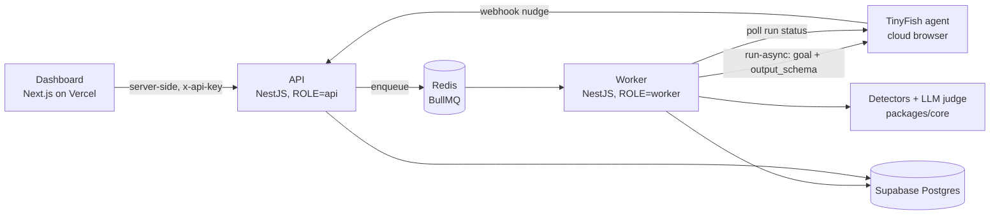

# Jhol: find the jhol in your checkout, before CCPA does

**Jhol is an AI agent that shops a website like a real customer, stops before payment, and reports every dark pattern it ran into (hidden fees, sneaked add-ons, fake timers, pre-ticked subscriptions), mapped to CCPA's 13 dark patterns, with the exact text as proof.**

---

## The problem

India's Central Consumer Protection Authority (CCPA) notified 13 dark patterns as unfair trade practices in 2023 and, in June 2025, told e-commerce platforms to self-audit and self-declare compliance. Those self-declarations came with no common checklist and no proof, and the tricks didn't go away:

- **97% of 290 major Indian platforms** still used dark patterns in LocalCircles' 2025 audit, including **21 of the 26** that had self-declared compliance.
- **~75% of consumers** say they've hit fees that appear only at checkout.
- Indian shoppers lose an estimated **₹25,000–28,000 crore a year** to dark patterns (Datum Intelligence).
- CCPA has now **fined nine platforms**, including IndiGo, Zepto, BookMyShow, PhysicsWallah, FirstCry and SpiceJet. PhysicsWallah's ₹5 lakh penalty included a ₹10 donation pre-added at checkout.
- Yet only **308** dark-pattern complaints reached the National Consumer Helpline from Dec 2023 to Mar 2026. People get tricked but can't detect or prove it.

The tricks live **deep inside the checkout** (step 4 or 5, after the cart), so scanning a homepage can't catch them. You have to actually shop. Today that's slow, manual work.

**Who it's for:** compliance and product teams at D2C brands and platforms (fix it before a CCPA notice), and shoppers (free checks, plus evidence for a complaint).

## What Jhol does

1. You paste a URL.
2. A TinyFish web agent shops like a first-time customer: it picks the cheapest product, adds one to the cart and goes through guest checkout. It never pays and never enters real personal data.
3. At every page it records prices, every line item, anything pre-selected, urgency claims, offer wording and popups, all as typed JSON.
4. A **second visit ~2 minutes later** checks whether the countdowns and "only N left" claims are real.
5. Detectors and an LLM judge turn that into findings. Each finding has the CCPA pattern, the page, the exact captured text, a severity, and a 0–100 **Jhol score**.
6. The report is **sealed with a SHA-256 hash**, so any later edit is detectable.

## How TinyFish is used

TinyFish isn't a side feature here; it's the product's eyes and hands. Checkout-stage dark patterns only exist inside a live, multi-step flow, so Jhol needs a real browser driven by a goal-following agent.

| TinyFish feature | How Jhol uses it | Code |
| --- | --- | --- |
| **Agent API** (`/v1/automation/run-async`) | Natural-language goal: shop as a guest, decline upsells, don't touch pre-selected items, **stop before payment** | `packages/core/src/tinyfish.ts` → `checkoutGoal()`, `startJourneyRun()` |
| **Structured output** (`output_schema`) | Every page comes back as typed JSON (total, line items, pre-selected options, urgency texts, choice texts, popups), so detectors are deterministic | `JOURNEY_SCHEMA` |
| **Live browser stream** (`streaming_url`) | The dashboard embeds the agent's live browser while it shops | `apps/web/.../audit-report.tsx` |
| **Proxies + stealth** (`proxy_config.country_code: "IN"`, `browser_profile: "stealth"`) | Indian prices and fees; works on bot-protected sites | `RunOptions` |
| **Webhooks** (`webhook_url`) + **run polling** (`GET /v1/runs/:id`) | Webhooks nudge the worker; polling stays the source of truth, so missed webhooks only cost seconds | `audits.processor.ts` |
| **Cancel** (`POST /v1/runs/:id/cancel`) | Runs that take too long are cancelled to cap credit spend | `checkRun()` |
| **Two independent sessions** | Visit B ~2 min after visit A: a real deadline keeps counting down, a fake one restarts; stock that goes *up* isn't real | `detectFalseUrgency()` |

## What it detects

| CCPA pattern | How | Example evidence |
| --- | --- | --- |
| Drip pricing | Rule: a fee not shown when the price first appeared | `Platform fee — ₹19` appears only on the review page |
| Basket sneaking | Rule: paid items/add-ons the shopper never added, or pre-ticked | `Donation to Green India Fund — ₹10` |
| Subscription trap | Rule: pre-ticked trial or membership that renews | `ChalakPlus 7-day free trial` |
| False urgency | Rule: two visits, timer restarts or stock goes up | `04:52` → `04:55` two minutes later |
| Nagging | Rule: the same popup on 3+ pages | "Get 10% off" on every page |
| Confirm shaming, trick question, disguised ad, forced action | LLM judge with CCPA definitions; **any quote the agent didn't actually capture is thrown away** | "No thanks, I don't mind if my order arrives broken" |
| Interface interference | Roadmap: screenshots + vision model | tiny grey "decline" vs big green "accept" |

## Test bench: Chalak Mart

`apps/web/public/lab/chalak-mart.html` is a **fictional** store with 9 planted dark patterns (ground truth in `ground-truth.json`). The price goes ₹499 → ₹558 → ₹606 by checkout. Rule detectors catch 7 of the 9 planted patterns on a mock run; confirm shaming goes to the LLM judge; interface interference needs vision (roadmap). Run it 3 times against live TinyFish and publish the numbers here.

## Architecture



- **apps/web**: Next.js 16 + Tailwind. The browser never talks to the API directly; server actions and route handlers do, with a shared key.
- **apps/api**: NestJS 11. One codebase, `ROLE=api | worker | all`. BullMQ jobs: `start-session` → `check-run` → `finalize`. Every step is idempotent and retried, and failures are recorded so an audit never hangs.
- **packages/core**: TinyFish client and detectors, shared and unit-tested.
- **supabase/migrations**: Postgres schema (audits, runs, findings), RLS locked.

## Run it locally

Needs Node 22 (`corepack enable` for pnpm), Docker (for Redis), a TinyFish key and a Supabase project.

```bash
pnpm install
docker compose up -d                               # Redis on :6379
cp apps/api/.env.example apps/api/.env              # fill TinyFish + Supabase keys, JHOL_API_KEY
cp apps/web/.env.example apps/web/.env.local        # same JHOL_API_KEY
# Supabase → SQL editor → paste supabase/migrations/0001_init.sql → Run
pnpm dev                                            # web :3000 · api + worker :4000
```

TinyFish's browser runs in the cloud, so it can't open `localhost`. Audit a public site, or deploy the web app and use the Chalak Mart button.

Tests:

```bash
pnpm --filter @jhol/core test                                    # detector unit tests
pnpm --filter @jhol/api build && pnpm --filter @jhol/api test:e2e  # full pipeline: fake TinyFish + real Redis
```

## Deploy

1. **Supabase**: run `supabase/migrations/0001_init.sql`.
2. **Railway**: add a Redis service. Then add **two services from this repo**, both with `RAILWAY_DOCKERFILE_PATH=apps/api/Dockerfile` and the variables from `apps/api/.env.example` (`REDIS_URL=${{Redis.REDIS_URL}}`):
   - **api**: `ROLE=api`. Generate a domain and set it as `PUBLIC_API_URL`.
   - **worker**: `ROLE=worker`. No domain needed.
3. **Vercel**: import the repo, set Root Directory to `apps/web`, and set env `API_URL` (the Railway api domain) and `JHOL_API_KEY`.

## Business model

| Plan | Price | For |
| --- | --- | --- |
| Free | ₹0 | Shoppers: one checkout scan, evidence pack and a ready-to-file complaint |
| Starter | ₹4,999/mo | D2C brands: 1 site, 3 journeys, weekly re-audit, CCPA-mapped report |
| Growth | ₹24,999/mo | 5 sites, daily monitoring, audit on every deploy |
| Enterprise | ₹5L+/yr | Platforms: logged-in journeys, custom flows, audit trail |

**Why these prices:**
- One CCPA penalty (Zepto paid ₹7 lakh) costs more than 11 years of Starter.
- Unit cost: TinyFish Agent is $0.015 per step on pay-as-you-go. At an assumed ~30 steps a run plus the LLM, that's ~₹50 a run. Starter (~13 runs a month) costs ~₹650 to serve, so margin is 85%+. Replace the assumption with real `num_steps` from your runs.
- Market: India has 10,000+ active D2C brands. At ₹60k/yr that's ~₹60 crore from D2C alone, before travel, edtech and quick commerce.

## Roadmap

- **AI shopping agents** are starting to pay over UPI. Jhol becomes a pre-payment check they call via API/MCP (`/v1/check`).
- **More journeys:** signup and consent (DPDP Rules), subscribe → cancel, account deletion.
- **Screenshots + vision** via TinyFish Browser API + Playwright, for interface interference.
- **Price tests:** iPhone vs Android, and pincode vs pincode.
- **Billing:** UPI via a self-hosted gateway behind a `PaymentProvider` interface, plus Razorpay AutoPay. Also orgs, API keys and scheduled monitoring.

## Sources

- [CCPA fines IndiGo, Zepto, BookMyShow and six others (Business Standard)](https://www.business-standard.com/industry/news/ccpa-fines-indigo-zepto-bookmyshow-dark-patterns-quick-commerce-penalty-126080600580_1.html)
- [Nine platforms fined; 308 NCH complaints (Angel One)](https://www.angelone.in/news/market-updates/ccpa-imposes-penalties-on-indigo-zepto-bookmyshow-and-6-other-platforms-over-dark-patterns)
- [97% of 290 platforms still use dark patterns (MediaNama)](https://www.medianama.com/2025/11/223-rti-25-platforms-dark-pattern-audits/)
- [21 of 26 self-declared platforms still show dark patterns (MediaNama via Third Eyesight)](https://www.thirdeyesight.in/tag/consumer-advocacy/)
- [75% faced checkout-only fees (MediaNama)](https://www.medianama.com/2025/10/223-localcircles-e-commerce-platforms-dark-patterns-hidden-fees/)
- [Self-declarations had no checklist or proof (UX Hack)](https://uxhack.substack.com/p/no-more-darkness)
- [PhysicsWallah ₹10 donation penalty (ETV Bharat / PTI)](https://www.etvbharat.com/en/bharat/ccpa-slaps-fines-on-physicswallah-mcafee-for-dark-pattern-practices-enn26060303886)
- [TinyFish Agent API reference](https://docs.tinyfish.ai/agent-api/reference) · [TinyFish pricing](https://tinyfish.ai/pricing)

## Team

_Add names and roles._
