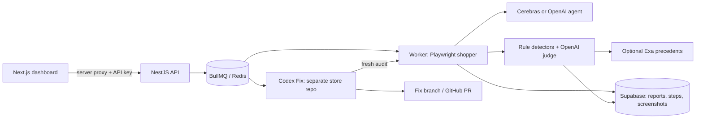

# Jhol — find the jhol in your checkout

Jhol shops a store as a first-time guest, captures checkout evidence, and reports dark patterns using the CCPA 2023 pattern names. For the configured demo store, **Fix with Codex** edits the store in a separate git branch and shops it again to produce before/after receipts. The shopper never pays.

## How it works



- **Playwright agent:** a model chooses one action from a compact DOM snapshot. Code captures preselected options, refuses sensitive field entry and final order submission, records page evidence before acting, and stops at payment. `JourneyResult` is the stable detector contract.
- **Cerebras/OpenAI:** `AGENT_LLM=cerebras|openai` selects the shopper; `--llm` overrides it in the CLI. Cerebras uses the OpenAI-compatible client at `https://api.cerebras.ai/v1`, model `gpt-oss-120b` by default. The agent requests strict JSON schema, falls back to `json_object` when rejected, and validates replies locally. Snapshot text targets a 6,000-character budget.
- **OpenAI judge:** worker and evals share one judge for wording-based findings. Its provider is independent of the agent setting. The worker can finish with rule findings when the judge is unavailable; evals require the judge configuration.
- **Exa precedents:** optional related government/news coverage, cached by pattern for 24 hours. Missing credentials or search failures do not fail an audit.
- **Netguard:** by default a forward proxy resolves and checks browser targets, blocks private/loopback/metadata addresses, and connects to the checked IP. `ALLOW_PRIVATE_TARGETS=true` enables local demo stores. Leave it unset or false for public deployments.
- **Evidence:** Supabase stores reports and step rows; JPEGs go in the public demo bucket `screens`. Screenshot failures retain the step without an image. A missing steps migration leaves the report readable, with a server warning. Reports include a SHA-256 seal.

API and worker share one NestJS application, selected with `ROLE=api|worker|all`. Jobs are `START_SESSION → FINALIZE`, plus `FIX`. The browser only calls Next.js route handlers/server actions; `JHOL_API_KEY` stays on the server.

## Run locally

Use Node 22+, pnpm and Docker for Redis.

```bash
corepack enable
pnpm install --frozen-lockfile
pnpm --filter @jhol/core exec playwright install chromium
docker compose up -d
cp apps/api/.env.example apps/api/.env
cp apps/web/.env.example apps/web/.env.local
```

Configure `apps/api/.env`:

- `SUPABASE_URL`, `SUPABASE_SERVICE_ROLE_KEY`, `REDIS_URL`, and `JHOL_API_KEY`.
- OpenAI shopping: `AGENT_LLM=openai`, `OPENAI_API_KEY`, and `OPENAI_MODEL` from your account. `OPENAI_BASE_URL` is optional.
- Cerebras shopping: `AGENT_LLM=cerebras`, `CEREBRAS_API_KEY`; optionally `CEREBRAS_MODEL`. Keep OpenAI configured for the judge.
- `EXA_API_KEY` is optional. Set `ALLOW_PRIVATE_TARGETS=true` for the local stores.

Set `API_URL=http://localhost:4000` and the same `JHOL_API_KEY` in `apps/web/.env.local`. Keep credentials in environment files; backup environment files are ignored by git and Docker.

### Supabase SQL

For a new project, run these in order in the Supabase SQL editor:

1. [0001_init.sql](supabase/migrations/0001_init.sql) — audits, runs, findings.
2. [0002_precedents.sql](supabase/migrations/0002_precedents.sql) — shared precedent cache and report precedents.
3. [0003_agent_steps.sql](supabase/migrations/0003_agent_steps.sql) — `run_steps` and the public `screens` Storage bucket.
4. [0004_codex_fix.sql](supabase/migrations/0004_codex_fix.sql) — fix status, branch/PR, Codex summary and re-audit link.

The checked project has all four migrations applied. Real UI checks verified persisted steps, public screenshots, fix metadata and receipts. For a new Supabase project, apply all four files above before starting audits. Missing historical screenshots cannot be recovered.

In separate terminals:

```bash
npx serve apps/web/public/lab -l 5050
pnpm dev
```

Open http://localhost:3000 and audit `http://localhost:5050/chalak-mart.html`. Web runs on 3000; API and worker run on 4000.

### CLI

```bash
pnpm --filter @jhol/core build
pnpm --filter @jhol/core agent http://localhost:5050/chalak-mart.html --llm openai
SESSION_B_DELAY_MS=60000 pnpm --filter @jhol/core agent http://localhost:5050/chalak-mart.html --llm openai --twice
# Optional visible browser: add --headed
```

The CLI loads `apps/api/.env`, saves screenshots and `journey.json` under `packages/core/runs/`, and prints failed-action reasons, prices, findings, steps and timings. Visit B starts after the configured delay from A's start, or when A finishes if it takes longer.

## Codex Fix demo

Use a separate clean git repository with a `main` branch. The checked setup is `../chalak-mart`, published at https://github.com/Shivanshu49/chalak-mart.

For a fresh setup:

```bash
mkdir ../chalak-mart
cp apps/web/public/lab/chalak-mart.html ../chalak-mart/index.html
git -C ../chalak-mart init -b main
git -C ../chalak-mart add index.html
git -C ../chalak-mart commit -m "Chalak Mart (with dark patterns)"
npm i -g @openai/codex
codex login
npx serve ../chalak-mart -l 5051
```

Fixes stay local by default. To publish PRs, explicitly set `FIX_PUBLISH_PR=true`, authenticate `gh`, and configure the store's GitHub `origin`. With publishing disabled or GitHub unavailable, the receipt shows the local branch and diff summary.

Set `FIX_REPO_PATH` to the **absolute** path of that clone, and `FIX_STORE_URL=http://localhost:5051/index.html` in `apps/api/.env`; restart the API/worker. Apply migration 0004 before requesting fixes.

Audit that exact URL, wait for the report, then click **Fix with Codex**. The API claims one fix and queues it. The worker creates `jhol-fix-…` from main, passes captured findings through stdin, commits only `index.html`, optionally publishes a PR, and queues a fresh one-session audit while serving the changed branch. Success requires a higher score and a lower final price. Receipts show both results. The worker restores main afterward; the fix remains on its branch and any PR is not merged. A fix left rechecking after a lost worker lease can recover from its saved completed re-audit.

Codex has a ten-minute deadline and uses `--sandbox workspace-write` / `approval_policy="never"`, replacing the removed `--full-auto` flag in the installed CLI; see [official non-interactive mode documentation](https://learn.chatgpt.com/docs/non-interactive-mode). Subprocesses use argument arrays, receive no application secrets, and have bounded output and timeouts. A repository lock prevents overlapping edits. Dirty failed edits are preserved for review rather than discarded.

Real UI/Supabase checks now verify the complete local fix flow: the actual report button ran Codex, saved a fix branch and `fixed_audit_id`, and displayed persisted before/after receipts after reload. The original-store check saved all **39 steps and screenshots**. [Verification records](evals/verification/README.md).

The existing [PR #1](https://github.com/Shivanshu49/chalak-mart/pull/1) was verified without a new push. Its exact published code now audits at **100/100 and ₹499, with no findings**, after correcting three Jhol extraction false positives: the shopper's own tee and two unchecked offers. The store code was unchanged for that control. The historical score-63 check retained only a summary; its exact after-findings are unavailable. The recovered PR receipt links to the fresh persisted audit. [Diagnosis and proof](evals/verification/FIX_DIAGNOSIS.md). The store was restored to clean `main`.

To repeat real browser and Supabase checks with `pnpm dev` running and publishing disabled:

```bash
node --env-file-if-exists=apps/api/.env apps/api/test/live-ui.cjs
UI_TARGET_URL=http://localhost:5051/index.html UI_TWICE=false UI_TRIGGER_FIX=true \
  node --env-file-if-exists=apps/api/.env apps/api/test/live-ui.cjs
```

## Measured evals — 1 November 2026

```bash
pnpm --filter @jhol/core eval --runs 3 --twice
```

The measured command used three **two-session** audits (six visits) of the original Chalak Mart, with the OpenAI `gpt-4.1-mini` shopper and OpenAI judge. Visit B started 120 seconds after A. All six visits reached payment at ₹499 → ₹606. The first completed three pairs are reported without resampling:

| Case | Planted behavior | Caught |
| --- | --- | --- |
| P1 | Restarting countdown | 3/3 |
| P2 | Changing stock claim | 2/3 |
| P3 | Auto-added donation | 3/3 |
| P4 | Preselected protection | 3/3 |
| P5 | Preselected subscription trial | 3/3 |
| P6 | Confirm shaming | 3/3 |
| P7 | Visual interface interference | Not supported |
| P8 | Both hidden fees | 3/3 |
| P9 | Repeated newsletter popup | 3/3 |

**23/24 supported case-runs: 95.8% coverage. Average 37.7 steps and 188.6 seconds per two-session audit**, including the wait between visits. Vision is excluded from the denominator. [Raw eval results](evals/results-2026-11-01T10-03-27-498Z.json) include all six journeys and findings.

Stock pairs were 3 → 3 (no finding), 5 → 2 (a low-severity change warning that could indicate real sales), and 4 → 5 (high-severity stock increase). The equal random draw explains the uncaught stock case. These numbers measure planted-case coverage, not precision: run 2 also produced an extra false-positive basket-sneaking finding for the shopper's own tee when the model omitted its added-item evidence. That limitation remains recorded rather than hidden by a rerun.

The separate Step-A check passed three times at ₹499 → ₹606, with exactly drip pricing ×2, basket sneaking ×2, subscription trap ×1 and nagging ×1. OpenAI totals were **54.5s, 80.3s and 65.8s**. Its two-session check reached payment twice and added false urgency ×2 in **144.6s**. [Agent check results](evals/agent-checks-2026-11-01.json).

**Cerebras benchmark: skipped because `CEREBRAS_API_KEY` is empty.** No comparative speed claim is made.

## Checks and layout

```bash
pnpm turbo run build
pnpm --filter @jhol/core test
pnpm --filter @jhol/api test:e2e
```

Core tests cover detectors, payment safety, netguard and eval accounting. API e2e tests use Redis DB 15, a stub shopper and in-memory storage; fix tests also use a temporary real git repo. These do not establish Supabase persistence. The Docker image installs Chromium and its Linux dependencies; an image build has not been checked in this session.

- `packages/core` — agent, snapshot, netguard, journey contract, detectors, shared judge, Exa and eval CLI.
- `apps/api` — NestJS API/BullMQ worker, evidence storage and Codex Fix.
- `apps/web` — Next.js dashboard, server-side proxies, saved evidence viewer and Codex receipts. The report redesign stays with the frontend teammate.
- `supabase/migrations` — numbered database/Storage changes.
- `apps/web/public/lab` — original fictional store and planted ground truth.
- `evals` — recorded CLI, worker and evaluation results.

[NOTES.md](NOTES.md) records verification history and distinguishes live Supabase checks from stubbed tests. Development work is on `devday`.
